# VideoSense: Multimodal Video Intelligence for Human Activity Recognition

Kruthika Virupakshappa

---

## 1. Introduction

Recognising human actions in video is the core capability behind fall
detection in elder care, rehabilitation monitoring, and smart environments.
Video adds a dimension that image models lack: **time**. The same frame can
belong to different actions, and the evidence often lies in how pixels move.

For this project I built **VideoSense**, a PyTorch pipeline on UCF101 with
five components:

1. **Preprocessing.** Videos are decoded into fixed-length `(C, T, H, W)`
   tensors, and dense Farneback optical flow is computed as a motion
   modality.
2. **3D CNNs.** C3D is trained from scratch, and a Kinetics-400-pretrained
   R(2+1)D-18 is fine-tuned for comparison.
3. **A Siamese network.** It is trained with contrastive and triplet loss
   and evaluated by 5-way 1-shot and 5-shot recognition of classes it never
   saw.
4. **A two-stream network.** It fuses an RGB (appearance) stream with an
   optical-flow (motion) stream. Six variants are compared in an ablation.
5. **Interpretation.** This covers confusion analysis, t-SNE with silhouette
   scores, and Grad-CAM saliency for video.

**Data.** Classification uses the handout's 10-class mini-UCF101:
Archery, BabyCrawling, Basketball, Fencing, HandstandWalking, PullUps,
PushUps, Surfing, WalkingWithDog and YoYo. It has 1,212 videos, split by the
official split 1 into **870 training and 342 test clips**. The full dataset
was verified to contain 101 classes and 13,320 videos. The Siamese encoder
is trained on 30 *other* UCF101 classes, chosen randomly with seed 42 (2,925
training and 1,152 validation clips), so the few-shot evaluation on the mini
classes covers truly unseen actions. All training ran on a Google Colab
A100 with bfloat16 mixed precision.

## 2. Methods

### 2.1 Video preprocessing (Part 1)

* **Frame sampling.** Each video is decoded once, and 32 uniformly spaced
  frames are cached at 128×171 (the 4:3 aspect ratio of UCF101). A training
  clip draws **T = 16** of these with TSN-style segment sampling (one random
  frame per segment, which acts as temporal jitter). It then takes a random
  112×112 crop with horizontal flip, applied identically to every frame.
  Test clips use 16 uniform frames and a centre crop. Normalisation uses
  ImageNet mean/std for the C3D-based models and Kinetics mean/std for
  R(2+1)D.
* **Tensor layout.** Frames are permuted `(T, H, W, 3) → (3, T, H, W)`, so
  a batch is `(B, C, T, H, W)`. The check printed by
  `part1_visualize.py` confirms the shapes: an RGB clip is
  `(3, 16, 112, 112)` float32, and a flow stack is `(2, 16, 112, 112)`
  float32.
* **Optical flow.** Farneback flow (pyr_scale 0.5, 3 levels, window 15,
  3 iterations, poly_n 5, sigma 1.2) is computed between frames *i* and
  *i+1* at 16 uniformly spaced positions, at 112×112, and stored as
  `(2, T, H, W)`. It was computed for all 1,212 mini videos. At load time it
  is normalised per clip to [-1, 1]. For augmentation it is mirrored by
  flipping W and negating u.
* **Fixes to the handout code.** `testlist01.txt` has no label column, so
  the reference loader (`if len(parts) >= 2`) silently dropped every test
  video. Its 1-based 101-class label is also invalid for a 10-class subset.
  Labels are therefore derived from the class folder.

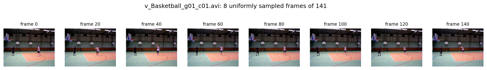
*Figure 1. Eight uniformly sampled frames (indices 0, 20, …, 140) from a
141-frame Basketball clip, about 0.8 s apart at 25 fps.*

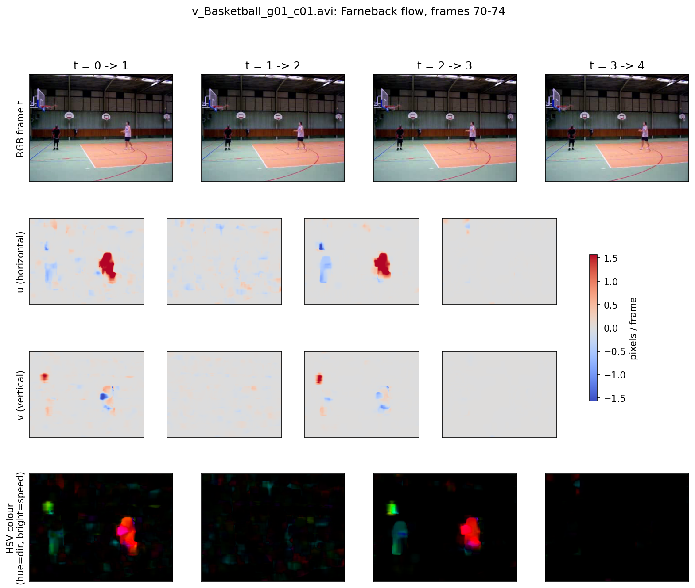
*Figure 2. Farneback flow for 4 consecutive frame pairs (frames 70–74) of
the same clip. Rows: RGB frame, horizontal component u, vertical component v
(red = positive, blue = negative, in pixels/frame), and the HSV colouring
from `cv2.cartToPolar` (hue = direction, brightness = speed). The player on
the right moves right (red in u and in the HSV image). The player on the
left moves left and down. The static court produces almost no flow.*

### 2.2 C3D and R(2+1)D (Part 2)

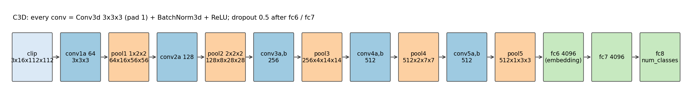
*Figure 3. C3D: eight 3×3×3 convolutions and five max-pools. The time
dimension shrinks 16 → 16 → 8 → 4 → 2 → 1; pool1 pools only spatially.*

* **C3D** follows the handout's layer list. I made one deliberate change:
  **BatchNorm3d after every convolution**. A VGG-depth network with a
  19M-parameter fc6, trained from scratch on 870 clips, is hard to optimise
  without it. Training: Adam (lr 3e-4, weight decay 1e-4), cosine annealing
  over 30 epochs, batch size 16, cross-entropy with label smoothing.
* **R(2+1)D-18** uses torchvision weights pretrained on Kinetics-400. The
  backbone is frozen, including its BatchNorm statistics, and only a new
  `fc` (512 → 10) is trained, for 10 epochs at lr 1e-3. The handout's
  `R2Plus1DBlock` is also implemented and shape-tested.

### 2.3 Siamese network (Part 3)

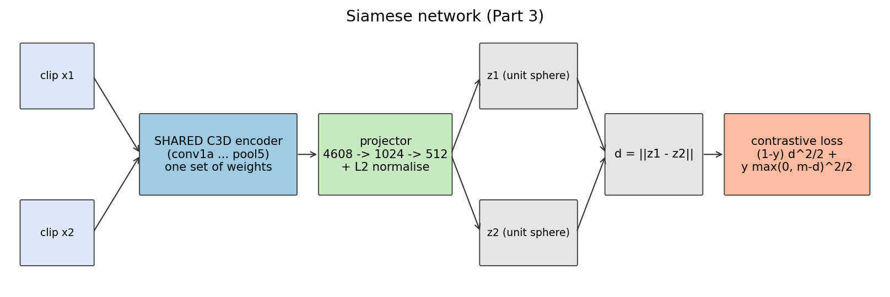
*Figure 4. One C3D encoder processes both clips, so the weights are shared by
construction. A projection head (4608 → 1024 → 512) and L2 normalisation
follow, then the Euclidean distance.*

* **Shared weights, verified.** There is exactly one encoder module, with
  27.7M of the network's 32.9M parameters. A built-in check confirms that
  the gradient of the summed branch outputs equals the sum of the
  per-branch gradients, accumulated in the same tensors.
* **Contrastive loss, verified:** `L = (1-y)·½d² + y·½·max(0, m-d)²`, with
  y = 0 for same-class pairs. On a 4-pair test case it returns 0.4375,
  equal to the hand-computed value.
* **Training:** balanced 50/50 pairs, 4,000 pairs per epoch, 20 epochs, Adam
  lr 3e-4. The triplet variant uses `max(0, d(a,p) - d(a,n) + 0.5)`.
* **Few-shot protocol:** 5-way, K ∈ {1, 5}, 15 queries per class, 200
  episodes, on the 10 unseen mini classes (test split). Queries are
  classified by 1-NN to the support clips, as in the handout. The prototype
  rule (nearest class mean) is reported as well. For comparison, the same
  protocol is also run on held-out clips of the 30 *seen* base classes.

### 2.4 Two-stream fusion (Part 4)

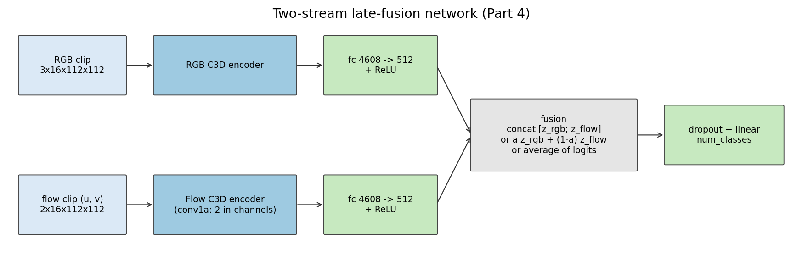
*Figure 5. Independent C3D encoders process RGB and flow. The flow stream's
conv1a has 2 input channels. Each stream is projected to a 512-d embedding,
then fused.*

Six variants are trained from scratch with the same recipe (30 epochs, Adam
3e-4, label smoothing 0.1):

* **rgb-only** and **flow-only**.
* **concat**: [z_rgb; z_flow] → linear.
* **average**: one classifier per stream, logits averaged.
* **attention**: α·z_rgb + (1−α)·z_flow, with α = sigmoid(θ) initialised at
  0.5 and given its own optimizer group.
* **cross-attention**: each stream's 9 pool5 tokens attend to the other
  stream's tokens (8 heads), followed by a residual connection, LayerNorm,
  mean pooling and concatenation.

### 2.5 Evaluation (Part 5)

* Top-1, top-5, per-class precision/recall and macro-F1.
* A row-normalised confusion matrix.
* t-SNE (perplexity 30) of C3D fc6 (4096-d), Siamese (512-d) and
  two-stream (1024-d) embeddings. Silhouette scores are computed both in
  the original space and in 2D.
* Grad-CAM on the last convolutional layer, upsampled to 16×112×112 and
  normalised globally. It is measured against motion with two statistics:
  the correlation r between the CAM and the flow magnitude, and the share
  of CAM mass on the 20% most-moving pixels (0.20 would be chance).
* Test-time augmentation with 5 temporal crops.

## 3. Results

### 3.1 Main comparison

| Model | Top-1 | Top-5 | macro-F1 | Params (trainable) | GFLOPs / clip |
|---|---|---|---|---|---|
| C3D from scratch (LS 0.1) | **51.8%** | 87.7% | 0.511 | 63.4 M (63.4 M) | 77.1 |
| R(2+1)D-18, Kinetics-pretrained, head-only | **93.9%** | 100.0% | 0.939 | 31.3 M (5,130) | 81.0 |
| Two-stream C3D, concat fusion | **67.0%** | 93.0% | 0.672 | 60.1 M (60.1 M) | 153.4 |

*Table 1. Test-split accuracy (342 clips), final-epoch weights. The test set
was never used to choose a checkpoint. The R(2+1)D training log reports
94.2%. Re-evaluating with `evaluate.py` gives 93.9%, a one-clip difference
caused by bf16 numerics at a different batch size.*

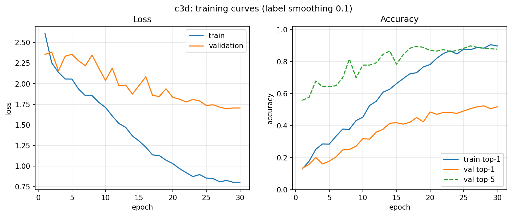
*Figure 6. C3D (label smoothing 0.1): loss and accuracy over 30 epochs.*

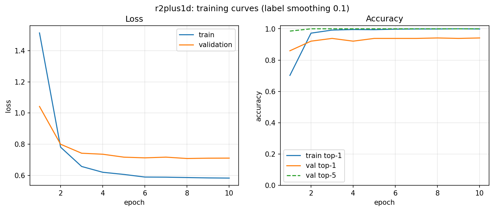
*Figure 7. R(2+1)D-18 head-only fine-tuning over 10 epochs.*

**C3D vs. R(2+1)D.** C3D trained from scratch reaches 51.8% top-1, which
meets the >50% target. It only crosses 50% at epoch 26, and it ends with
89.7% training accuracy, a **38-point train–test gap**: with 63M parameters
and 870 clips, it largely memorises. The validation loss levels off around
1.7 while the training loss keeps falling (Figure 6).

The pretrained R(2+1)D is already at **86.0% after one epoch** and finishes
at **93.9% top-1 / 100% top-5**. That is 42 points better than C3D, while
training only 5,130 parameters. Generic Kinetics-400 spatiotemporal features
are enough for a linear classifier to separate these ten actions (see Q12).

**Complexity trade-off.** The two backbones cost about the same compute
(77 vs. 81 GFLOPs per clip). R(2+1)D has *half* the parameters, because
C3D's fc6 and fc7 alone hold 35.7M of its 63.4M. Most of C3D's capacity is
therefore in fully connected layers that are cheap to run but easy to
overfit. R(2+1)D is deeper (18 layers) and uses residual connections and a
(2+1)D factorisation. Pretraining and architecture both mattered far more
than raw parameter count.

### 3.2 Label smoothing (C3D)

| label_smoothing | Top-1 | Top-5 | Train top-1 | Train-test gap | Epoch first ≥ 50% |
|---|---|---|---|---|---|
| 0.0 | 51.5% | 90.6% | 86.2% | 34.8 pts | 24 |
| 0.1 | 51.8% | 87.7% | 89.7% | 37.9 pts | 26 |
| 0.2 | **61.4%** | 90.9% | 92.0% | **30.6 pts** | **16** |

*Table 2. C3D with three label-smoothing values. Everything else is
identical.*

Label smoothing replaces the one-hot target with (1−ε)·onehot + ε/K. This
limits how large the logits can grow and makes the model less
overconfident. ε = 0.2 gave the best test accuracy (+9.6 points over ε = 0.1)
and the smallest generalisation gap, and it passed 50% ten epochs earlier.
The difference between ε = 0 and ε = 0.1 (0.3 points, one clip) is within
run-to-run noise. Each setting was run once (seed 42), so the ε = 0.2 gain
is suggestive rather than conclusive. It is consistent with stronger
regularisation helping a heavily over-parameterised model on a small
dataset.

### 3.3 Few-shot recognition with the Siamese network

| Training loss | margin | 1-shot unseen | 5-shot unseen | 5-shot unseen, prototype | 1-shot seen base | 5-shot seen base | Final val d+ / d− |
|---|---|---|---|---|---|---|---|
| contrastive | 1.0 | 26.7 ± 6.0 | 33.8 ± 6.5 | 28.2 | 43.9 | 54.2 | 0.27 / 0.49 |
| contrastive | **2.0** | 30.7 ± 8.6 | 36.2 ± 6.9 | 35.7 | 48.4 | 58.7 | 0.59 / 1.09 |
| contrastive | 4.0 | 25.6 ± 6.6 | 34.7 ± 7.0 | 28.2 | 40.1 | 54.2 | 0.80 / 1.25 |
| triplet | 0.5 | **35.5 ± 10.2** | **40.9 ± 8.2** | **41.3** | **54.7** | **63.5** | 0.58 / 1.12 |

*Table 3. 5-way accuracy (%) as mean ± std over 200 episodes with 15 queries
per class. Chance is 20%. "Unseen" = the 10 mini classes, never used in
training. "Seen base" = held-out clips of the 30 training classes. The last
column is the mean positive/negative pair distance on base-class
validation pairs.*

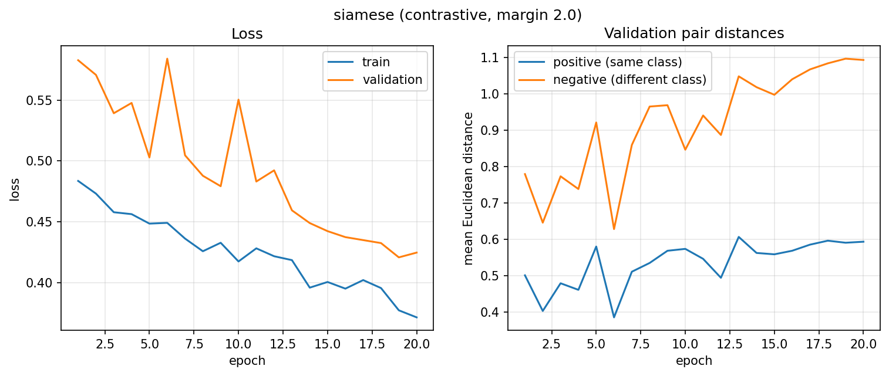
*Figure 8. Contrastive training (m = 2): the loss decreases, and the mean
validation distance of negative pairs rises from 0.78 to 1.09 while
positive pairs stay near 0.6.*

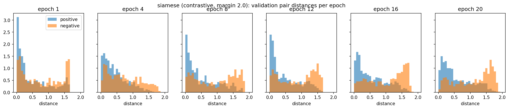
*Figure 9. Validation distance distributions for positive and negative
pairs at selected epochs (m = 2). The two distributions separate as training
progresses.*

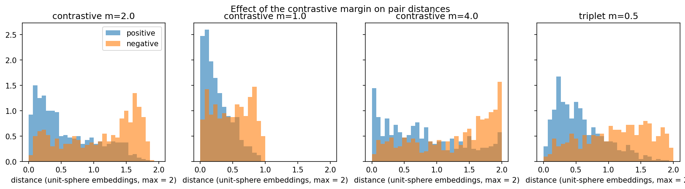
*Figure 10. Final distance histograms for each margin and for triplet loss.
Embeddings lie on the unit sphere, so d ∈ [0, 2].*

**Discussion.**
1. **It works, but transfer to unseen classes is limited.** Every run is
   well above the 20% chance level. 5-shot beats 1-shot in every
   configuration (by 5–9 points), because more support clips cover more of
   each class's variation. However, seen-base accuracy is far higher than
   unseen accuracy (48.4% vs. 30.7% 1-shot for m = 2). The metric learned
   from scratch on ~2,900 clips of 30 classes captures base-class cues more
   than general action similarity. This matches the negative silhouette of
   the Siamese embeddings on the unseen classes (Section 3.7).
2. **The margin shapes the geometry as predicted** (Figure 10).
   * With **m = 1**, negatives are no longer pushed once d ≥ 1. The whole
     embedding stays inside [0, 1]: d− is only 0.49, and positives and
     negatives overlap heavily.
   * With **m = 4**, the margin exceeds the largest possible distance (2),
     so every negative pair is always pushed. The negative histogram piles
     up at d ≈ 2, and the push also inflates positive distances (d+ = 0.80),
     which gives the worst 1-shot accuracy.
   * **m = 2** is the best contrastive setting.
3. **Triplet loss is best overall** (+4.8 points at 1-shot). It only
   requires positives to be *closer than* negatives, and that ranking is
   exactly what 1-NN uses, whereas contrastive loss forces absolute
   distances.
4. **Prototype vs. 1-NN.** The prototype rule matches 1-NN for m = 2 and
   triplet, but drops to 28.2% for m = 1 and m = 4. When class clusters are
   spread out or multi-modal, their mean can fall between the modes.

### 3.4 Two-stream ablation

| Variant | Top-1 | Top-5 | Train top-1 | Learned α (RGB weight) |
|---|---|---|---|---|
| RGB only | 57.3% | 90.4% | 91.8% | - |
| Flow only | 51.5% | 90.9% | 94.8% | - |
| **Late fusion, concat** | **67.0%** | 93.0% | 98.6% | - |
| Late fusion, logit average | 66.7% | **94.4%** | 99.4% | - |
| Attention-weighted | 61.7% | 92.1% | 99.2% | 0.436 |
| Cross-attention | 63.7% | 92.7% | 99.7% | - |

*Table 4. All variants were trained from scratch with the same recipe.*

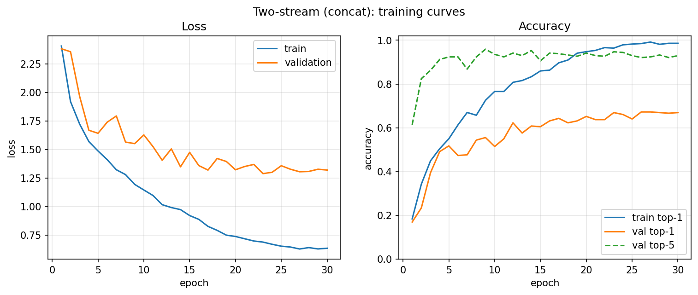
*Figure 11. Two-stream concat: training curves over 30 epochs. Validation
accuracy passes 50% at epoch 5, versus epoch 16 for RGB-only.*

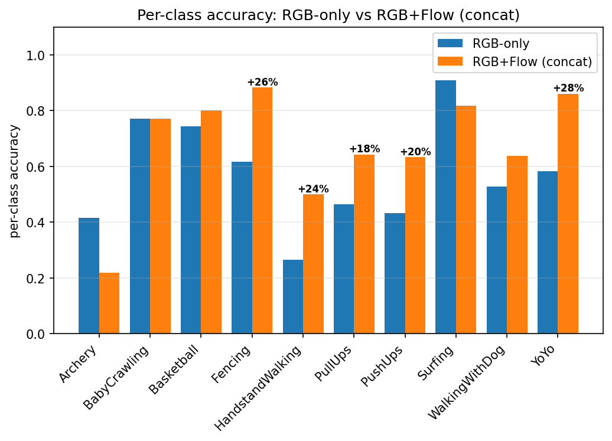
*Figure 12. Per-class accuracy for RGB-only vs. RGB+Flow (concat). The five
largest gains are annotated.*

**Fusion clearly helps.** Every fusion variant beats both single streams.
Concat gains **+9.7 points over RGB-only** and +15.5 over flow-only, and it
is +15.2 points above the Part 2 C3D (51.8%). Two other results are worth
noting:
* RGB alone is more informative than flow alone (57.3% vs. 51.5%), yet the
  two are clearly complementary. The plain fusions (concat, average) beat
  the learned ones (attention, cross-attention). With only 870 training
  clips, the extra fusion parameters seem to overfit (train accuracy ≈ 99%
  for all variants).
* The RGB-only stream (57.3%) beats the Part 2 C3D (51.8%) even though it
  uses the same convolutional backbone. The stream replaces C3D's
  4608 → 4096 → 4096 classifier with a single 4608 → 512 projection, which
  removes ~35M parameters and reduces overfitting.

**Where motion helps most** (Figure 12):

| Class | RGB-only | RGB+flow | Gain | Why motion matters |
|---|---|---|---|---|
| YoYo | 58% | 86% | +28 | The yo-yo is a few pixels in RGB, but its fast up-and-down motion is a strong flow signature |
| Fencing | 62% | 88% | +26 | Rapid back-and-forth lunges of two opponents |
| HandstandWalking | 26% | 50% | +24 | A walking gait while upside down; in RGB, a small figure in a gym |
| PushUps | 43% | 63% | +20 | Vertical oscillation of a horizontal body |
| PullUps | 46% | 64% | +18 | Vertical oscillation of a hanging body |

All five are defined by **how** the body or object moves rather than by the
scene. In contrast, appearance-defined classes lose accuracy with fusion:
Archery drops from 41% to 22%, and Surfing from 91% to 82%. Archery is
mostly static (aiming), so its flow is close to noise. Surfing is
recognised from water texture alone.

**Learned α.** α fell steadily from 0.50 to **0.436** over training. The
model gives slightly *more* weight to motion than to appearance, but stays
close to 0.5, so it relies on both streams (see Q27).

### 3.5 Full evaluation report (best model: R(2+1)D-18)

| Class | Precision | Recall | F1 |
|---|---|---|---|
| Archery | 0.864 | 0.927 | 0.894 |
| BabyCrawling | 0.921 | 1.000 | 0.959 |
| Basketball | 0.972 | 1.000 | 0.986 |
| Fencing | 0.971 | 1.000 | 0.986 |
| HandstandWalking | 0.871 | 0.794 | 0.831 |
| PullUps | 1.000 | 0.857 | 0.923 |
| PushUps | 1.000 | 1.000 | 1.000 |
| Surfing | 1.000 | 1.000 | 1.000 |
| WalkingWithDog | 0.921 | 0.972 | 0.946 |
| YoYo | 0.909 | 0.833 | 0.870 |
| **Macro average** | **0.943** | **0.938** | **0.939** |

*Table 5. Top-1 93.9%, top-5 100%. HandstandWalking and YoYo are the
weakest classes, which matches the Grad-CAM failure case in Section 3.8.*

For comparison, C3D's macro-F1 is 0.511, and its weakest classes are PushUps
(F1 0.246), Archery (0.347) and HandstandWalking (0.349). The two-stream
model's macro-F1 is 0.672.

### 3.6 Confusion matrix and confused pairs

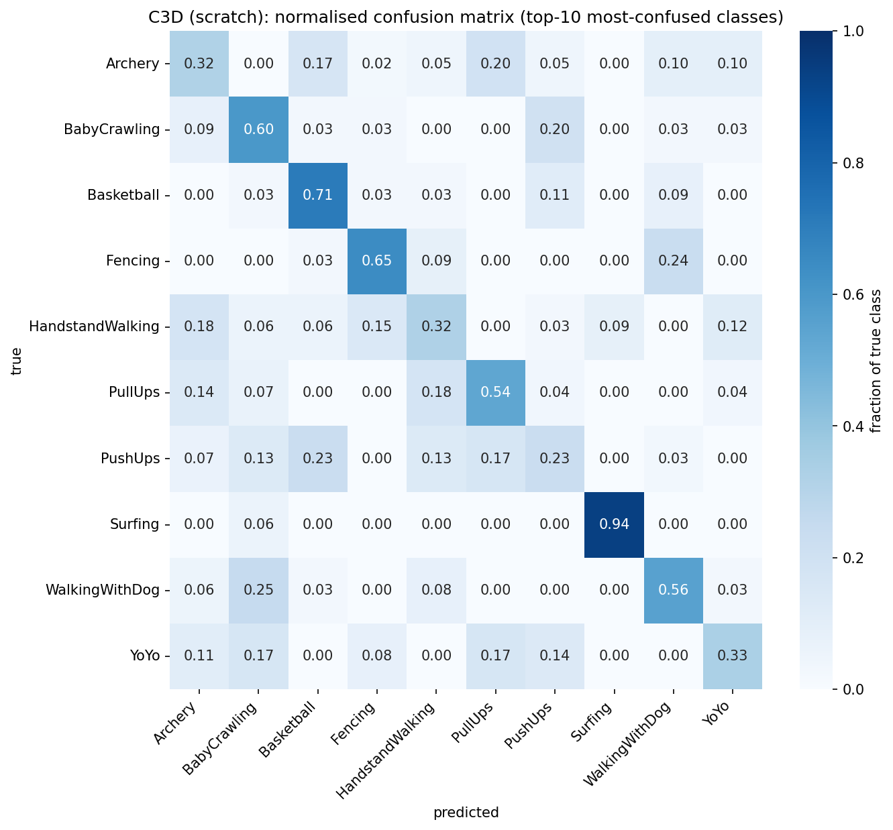
*Figure 13. Row-normalised confusion matrix for C3D. With 10 classes, all
are shown; the code keeps the 20 most-confused classes when there are more.
I analyse C3D because it makes enough errors to study; R(2+1)D's matrix is
almost diagonal.*

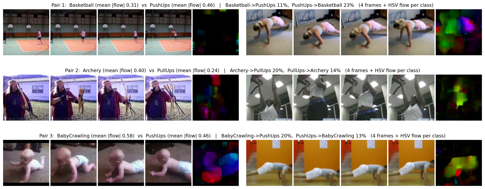
*Figure 14. Visual evidence for the three most-confused pairs, ranked by
symmetric confusion cm[a,b] + cm[b,a]. Each row shows four frames and an HSV
flow image from a misclassified clip of each class, plus the mean flow
magnitude of each class over the test split.*

| Pair | a→b / b→a | Main cause | Evidence |
|---|---|---|---|
| Basketball ↔ PushUps | 11% / 23% | Appearance: indoor gym scenes | Both share floors, walls and gym lighting. Their motion differs (mean flow 0.31 vs. 0.46): Basketball players are small and far away, so the frame is dominated by the static court |
| Archery ↔ PullUps | 20% / 14% | Pose and low motion | An upright person with arms raised (drawing a bow vs. gripping a bar), plus long vertical structures (bow vs. bar). Both have little motion (0.40 vs. 0.24) |
| BabyCrawling ↔ PushUps | 20% / 13% | Pose *and* motion | A horizontal body close to the floor, hands on the ground, with similar motion energy (0.58 vs. 0.46) and a rhythmic movement |

**Pair 1, Basketball ↔ PushUps.** The confusion is appearance-driven. Both
are filmed indoors, with the floor taking up most of the frame. The flow
image of the Basketball clip is almost black, because the players are tiny.
A from-scratch C3D at 112 px sees mostly the room, so "indoor floor + wall"
becomes a shortcut. The Grad-CAM of a PushUps clip (Section 3.8) confirms
that C3D does not attend to the body.

**Pair 2, Archery ↔ PullUps.** The confusion is pose-driven. Drawing a bow
and hanging from a bar both produce an upright silhouette with arms near
the head, and both actions are slow, so motion does not separate them
either. Grad-CAM shows C3D *does* attend to the archer's torso in the
Archery example and still predicts PullUps. It found the person, but it
cannot read the pose.

**Pair 3, BabyCrawling ↔ PushUps.** Both pose and motion are similar. The
cue that separates them is the *direction* of motion: crawling moves
horizontally across the frame (one consistent hue in the flow image),
while push-ups oscillate vertically in place. With 16 frames spaced ~0.45 s
apart, a periodic up-down movement is easily aliased.

Two more one-directional confusions are visible in Figure 13:
WalkingWithDog → BabyCrawling (25%) and Fencing → WalkingWithDog (24%).

**Fusion helps exactly on these pairs.** With flow added, PushUps recall
rises from 0.23 (C3D) to 0.63 (two-stream), and its precision reaches
1.00.

### 3.7 t-SNE and silhouette analysis

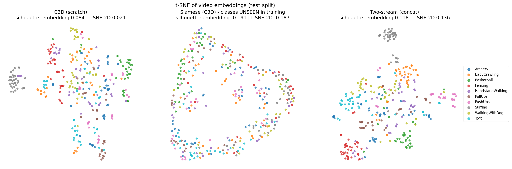
*Figure 15. t-SNE of test-set embeddings: (a) C3D fc6, (b) the Siamese
encoder, whose 10 classes were never seen in training, (c) the fused
two-stream embedding.*

| Embedding | dim | Silhouette (Euclidean) | Silhouette (cosine) | Silhouette (t-SNE 2D) | Top-1 |
|---|---|---|---|---|---|
| C3D fc6 | 4096 | 0.084 | 0.106 | 0.021 | 51.8% |
| Siamese (unseen classes) | 512 | −0.191 | −0.290 | −0.187 | 30.7% (1-shot) |
| Two-stream concat | 1024 | 0.118 | 0.185 | 0.136 | 67.0% |
| R(2+1)D pooled (extra) | 512 | 0.165 | 0.285 | 0.453 | 93.9% |

**Comparison.**
* **C3D** forms only a few clean islands: Surfing (grey) and Basketball
  (green). The rest overlap in a central cloud, which matches its silhouette
  of 0.084.
* **Two-stream** has more distinct clusters. Surfing, Fencing (red),
  Basketball and BabyCrawling separate, and PushUps moves into its own
  region. Its silhouette is higher (0.118, or 0.185 with cosine), in line
  with its 15-point accuracy gain.
* **The Siamese embedding** of unseen classes forms a ring with all classes
  mixed. The **negative silhouette** means a typical clip is, on average,
  closer to clips of *other* classes than to its own. This is the
  geometric reason its 1-shot accuracy is only 30.7%. The metric learned on
  30 base classes does not organise the 10 new ones (compare the 48.4%
  achieved on seen classes).
* **R(2+1)D** forms the clearest 2D clusters (0.453).

Two caveats apply to all of these numbers. Cosine silhouette is higher than
Euclidean for every model, because embedding norms vary and cosine ignores
norm. And the 2D silhouette can differ a lot from the high-dimensional one
(R(2+1)D: 0.165 vs. 0.453), because t-SNE exaggerates local cluster
structure. See Q35.

### 3.8 Grad-CAM

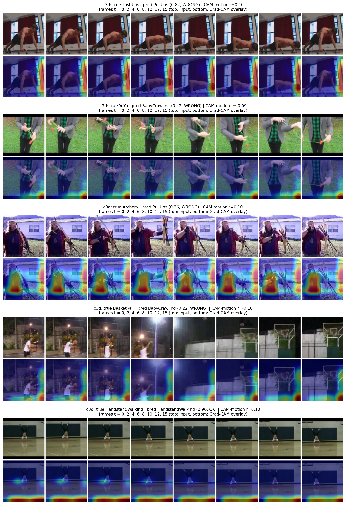
*Figure 16. Grad-CAM for C3D on 5 test clips from 5 classes (input frames on
top, overlay below). Animated GIFs are in `figures/gradcam/`.*

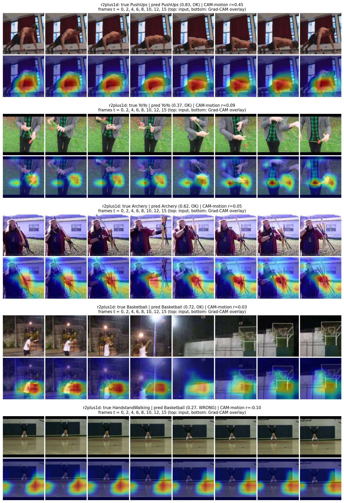
*Figure 17. The same 5 clips with R(2+1)D-18 (target: layer4).*

| Clip | C3D: prediction | C3D: r(CAM, motion) / mass on motion / mass in centre | R(2+1)D: prediction | R(2+1)D: r / motion / centre |
|---|---|---|---|---|
| PushUps g04_c03 | PullUps ✗ | 0.10 / 0.23 / 0.04 | PushUps ✓ (0.83) | **0.45 / 0.43 / 0.44** |
| YoYo g05_c03 | BabyCrawling ✗ | −0.09 / 0.15 / 0.00 | YoYo ✓ (0.37) | 0.09 / 0.24 / 0.53 |
| Archery g04_c01 | PullUps ✗ | 0.10 / 0.23 / 0.31 | Archery ✓ (0.62) | 0.05 / 0.22 / 0.45 |
| Basketball g06_c04 | BabyCrawling ✗ | −0.10 / 0.16 / 0.00 | Basketball ✓ (0.72) | 0.03 / 0.17 / 0.37 |
| HandstandWalking g05_c06 | HandstandWalking ✓ (0.96) | 0.10 / 0.21 / 0.08 | Basketball ✗ (0.27) | −0.10 / 0.17 / 0.18 |

*Table 6. Chance levels: mass on the top-20% motion pixels = 0.20; mass in
the central 50% region = 0.25.*

**Observations.**

1. **C3D's attention is mostly not content-relevant.** In 4 of 5 clips its
   heat sits on the **frame borders and corners**: the right edge for
   PushUps, the bottom-right corner for YoYo, the bottom band for
   Basketball and HandstandWalking. The centre-mass values of 0.00–0.08
   (chance 0.25) and CAM–motion correlations near zero confirm this
   quantitatively. Border attention is typical of a network trained from
   scratch on little data. It learns the zero-padding boundary and global
   layout cues rather than the actor, which explains much of its 51.8%
   accuracy. The exception is **Archery**, where it focuses on the
   archer's torso but still predicts PullUps (pair 2 above).
2. **R(2+1)D attends to the action.**
   * For **PushUps**, the heat covers the moving body: r = 0.45, and 43% of
     the CAM mass falls on the most-moving pixels, more than twice chance.
   * For **YoYo**, it tracks the hands and the yo-yo.
   * For **Archery**, it sits on the hands and the arrows being handled.
   * For **Basketball**, it covers the player and ball in the early frames.
   These match where a human would look. Centre mass is 0.37–0.53, above
   chance.
3. **A scene shortcut even in the strong model.** R(2+1)D misclassifies the
   HandstandWalking clip as **Basketball**, and its heat is on the gym floor
   and court lines, not on the upside-down person. The clip was filmed in a
   basketball gym, so the model used the scene instead of the action. This
   is the spurious correlation described in Q33.
4. **Little variation over time.** For both models the last conv layer has
   only T = 2, so the CAM changes slowly across the 16 frames. The temporal
   profiles in `gradcam_stats.json` vary by at most about 0.05 within a
   clip.

### 3.9 Test-time augmentation (bonus)

| Model | Single clip | 5 temporal crops | Gain |
|---|---|---|---|
| C3D | 51.8% | 51.5% | −0.3 |
| R(2+1)D | 93.9% | 93.9% | 0.0 |

TTA gave no gain. The single-clip evaluation already samples 16 frames
uniformly across the whole video. The 5 random segment-sampled views are
drawn from the same 32 cached frames, with one of two adjacent frames per
segment, so they are nearly identical to the single view and add almost no
diversity. Meaningful TTA would need spatial crops (corners and flips) or
dense temporal windows at a finer frame rate.

## 4. Reflection answers

### Part 1

**Q1. Why sample a fixed number of frames? What is lost, and how can it be
mitigated?**
Convolutional and fully connected layers need fixed-size inputs to form
batches. C3D's classifier in particular expects exactly 512×1×3×3 features.
A fixed T also fixes memory and compute per clip. The cost has two parts.
First, temporal resolution now varies with video length: picking 16 frames
from a 180-frame clip leaves ~11 frames (~0.45 s) between samples, so fast
events can fall between samples, periodic motion can be aliased, and speed
is no longer comparable across videos. Second, information about duration
is lost. Mitigations:
1. Segment-based sampling with random offsets during training (used here).
2. Multi-clip or dense-window testing, averaging predictions.
3. Larger T, or consecutive windows for short actions.
4. Multi-rate designs such as SlowFast.
5. Temporal pooling or attention, so the network accepts variable length.

**Q2. Distinguishing camera pan from subject motion.**
A pan adds an almost uniform translation (or, more generally, a homography)
to every pixel's flow, while subject motion is local. In the Surfing clip
(`part1_camera_motion.png`), the camera pans to follow the surfer. The raw
flow is dominated by a global shift of **(u, v) = (3.40, 0.01) px/frame**,
a purely horizontal pan, which is the solid red that fills the raw HSV
image. The letterbox bars are excluded from the estimate. Subtracting this
median flow vector removes the pan and leaves the surfer and the breaking
wave as the only distinct motion. More
robust options:
1. Fit a RANSAC homography to feature matches, warp the frame with it, and
   recompute flow (as in Improved Dense Trajectories).
2. Use flow gradients (motion boundaries): they are zero under a pure
   translation.
3. Compare flow inside and outside a detected person box.
For lighting changes, which break Farneback's brightness-constancy
assumption, use gradient-constancy flow, per-frame intensity normalisation,
or a learned flow network such as RAFT.

**Q3. Running vs. walking flow.**
UCF101 has no "Running" class, so I compared WalkingWithDog with the
LongJump run-up (a sprint), plus HandstandWalking
(`part1_flow_comparison.png`):

| Clip | Mean flow magnitude | 95th percentile |
|---|---|---|
| WalkingWithDog | 0.31 px/frame | 1.10 |
| HandstandWalking | 0.92 px/frame | 3.06 |
| LongJump (sprint) | 2.14 px/frame | 11.84 |

The sprint produces about **7×** the mean flow and **10×** the 95th
percentile of walking. Its histogram has a long tail beyond 30 px/frame,
caused by fast limbs and the camera following the jumper. On the shared
colour scale, its HSV images are saturated over most of the frame, while
the walking clips stay dark. Walking flow is
small, smooth and concentrated on the legs and the dog. Qualitatively, the
sprint flow also changes much faster from frame to frame (higher-frequency
periodicity) and covers most of the frame because of camera tracking.
For the network, this means speed and periodicity are discriminative, so
the flow stream should keep magnitude information. Our per-clip
normalisation to [−1, 1] removes absolute speed: it makes flow robust to
camera distance but discards the cue that best separates walking from
running. A fixed global scale (for example, clipping at ±20 px) would keep
it.

### Part 2

**Q11. Temporal receptive field of C3D.**
Using r ← r + (k−1)·j and j ← j·s along the time axis:

| layer | conv1a | pool1 | conv2a | pool2 | conv3a | conv3b | pool3 | conv4a | conv4b | pool4 | conv5a | conv5b | pool5 |
|---|---|---|---|---|---|---|---|---|---|---|---|---|---|
| RF (frames) | 3 | 3 | 5 | 6 | 10 | 14 | 16 | 24 | 32 | 36 | 52 | 68 | 76 |
| jump | 1 | 1 | 1 | 2 | 2 | 2 | 4 | 4 | 4 | 8 | 8 | 8 | 16 |

The theoretical temporal receptive field after pool5 is **76 frames**,
more than the 16 input frames, so each pool5 unit can see the whole clip
(padding fills the rest). The *effective* receptive field is smaller and
weighted towards the centre. This has two consequences. First, the model
reasons only over its 16 sampled frames. With uniform sampling those span
the whole video at ~0.45 s spacing, so it sees long-range structure, but
coarsely. Second, the time dimension collapses quickly (T = 2 after pool4,
T = 1 after pool5), so ordering information must be encoded in the channels
by conv5. C3D is good at "what kind of motion" and weak at precise ordering
or at events shorter than one sampling interval. Our Grad-CAM shows this
directly: with T = 2 at the last conv, the saliency barely changes over
time.

**Q12. Why does pretrained R(2+1)D beat C3D from scratch?**
In our run, R(2+1)D reaches 93.9% vs. C3D's 51.8%, and it is already at
86.0% after one epoch. Kinetics-400 has ~240k training clips in 400 classes;
our split has 870. The early and middle 3D-conv layers learn generic
spatiotemporal primitives (edges, motion-direction detectors, body and
object parts) that transfer, because human actions share low-level motion
statistics. Many UCF101 actions also have Kinetics counterparts. C3D's 63M
parameters trained on 870 clips memorise instead (89.7% training accuracy,
a 38-point gap), and its Grad-CAM shows it attending to frame borders.
R(2+1)D's frozen features let a 5,130-parameter linear head fit with almost
no overfitting, and its Grad-CAM falls on the actors. This shows that
feature reuse is very effective: a linear classifier on Kinetics features
is enough. Two caveats:
1. The comparison also changes the architecture (residual connections,
   (2+1)D factorisation, depth). Training R(2+1)D from scratch would
   separate the two effects.
2. Kinetics and UCF101 are both YouTube videos, so the domain shift is
   small; transfer to hospital CCTV would be weaker.

**Q13. BatchNorm with very small batches (B = 2).**
BatchNorm3d estimates per-channel statistics over (B, T, H, W). With B = 2,
the T·H·W positions inside a clip are highly correlated, so the effective
sample size is about 2 videos. The estimates become noisy and biased
towards those clips. Gradients get noisier, the running statistics used at
test time disagree with the per-batch statistics seen in training, and
accuracy drops or training diverges. Alternatives:
1. GroupNorm, LayerNorm or InstanceNorm, which do not depend on the batch.
2. Freezing BN at pretrained statistics, as done for our R(2+1)D.
3. SyncBatchNorm across GPUs.
4. Batch Renormalization.
5. A larger batch through bf16 or smaller crops.
Gradient accumulation does *not* fix BN, because each forward pass still
sees only 2 clips.

### Part 3

**Q18. Why L2-normalise embeddings?**
On the unit sphere, d ∈ [0, 2] and ‖a−b‖² = 2 − 2·cos(a, b). Euclidean
distance becomes a monotone function of cosine similarity, and the margin
has a fixed, interpretable scale. Without normalisation the network has a
shortcut: it can satisfy the negative term by inflating embedding norms
and collapse positives by shrinking them, without learning anything
semantic. The loss scale would also drift. Normalisation removes that
degree of freedom and forces similarity to be encoded in direction. A
consequence, visible in our margin study: m must be < 2 to be satisfiable.
With m = 4, every negative pair is always pushed, the negative distances
pile up at the maximum of 2 (Figure 10), and accuracy is the lowest.

**Q19. What if 90% of the pairs were negative?**
The loss and gradient would be dominated by the negative term. Once most
negatives are beyond the margin they contribute zero loss, so the few
positives give a weak pulling signal. The easiest solution is to spread all
embeddings apart. That keeps negatives far away but never makes same-class
clips close, which leads to loose clusters and poor 1-NN accuracy. A
pair-verification metric could still look good by always predicting
"different". The loss would drop quickly and then plateau. Remedies:
balanced sampling (as implemented), re-weighting the two terms, or
hard-negative mining.

**Q20. How does the embedding geometry change during training?**
At initialisation, positive and negative pairs are nearly indistinguishable.
In our m = 2 run, the mean validation distance was 0.50 for positive pairs
and 0.78 for negative pairs at epoch 1, with heavily overlapping histograms
(Figure 9). Training pulls same-class points together and pushes
different-class points out towards the margin. By epoch 20 the means are
0.59 and 1.09, and the histograms show a clear negative mode near 1.6.
In the ideal space:
1. Every intra-class distance is smaller than every inter-class distance
   (by a margin), so 1-NN makes no errors.
2. Clusters are spread uniformly over the sphere ("alignment and
   uniformity").
3. Distance reflects the action, not nuisance factors such as background
   or camera.
4. This structure also holds for *unseen* classes.
Our run achieved this partially on the seen classes, but not on the unseen
ones (negative silhouette). That is the gap between metric learning on 30
classes and true generalisation.

### Part 4

**Q25. What would middle fusion look like?**
The streams would be fused at intermediate feature maps, for example after
conv3 or conv4, by concatenating or summing per position (or with a 1×1×1
conv), followed by a single shared tower (Feichtenhofer et al., 2016;
SlowFast lateral connections are a variant). Advantages:
1. It learns pixel-aligned appearance–motion interactions ("this hand is
   moving upward"), which late fusion of two global vectors cannot express.
2. The shared upper layers need fewer parameters than two full towers.
3. It often outperforms late fusion.
Our cross-attention variant is a step in this direction, since it fuses
spatial tokens, but it uses the final 3×3 maps. It reached 63.7%, below
concat (67.0%), probably because the extra attention parameters overfit on
870 clips. Real middle fusion needs RGB and flow to be spatially aligned.
In our pipeline they are not (RGB is a centre crop of 128×171, while flow is
the full frame resized to 112×112), so that would need fixing first.

**Q26. A lightweight alternative to optical flow for real-time use.**
1. RGB frame differences, as in TSN's RGB-diff: nearly free to compute.
2. Compressed-domain motion vectors stored in H.264/MPEG-4 streams (CoViAR,
   MV-CNN): no flow computation at all.
3. Motion learned inside the RGB network: Temporal Shift Module (zero extra
   FLOPs) or MotionSqueeze.
4. Distillation (MARS): train an RGB network to imitate the flow stream, so
   flow is needed only during training.
5. If true flow is needed: OpenCV's DIS flow at low resolution, or
   RAFT-small on a GPU.
Our results justify the effort: flow added 9.7 points over RGB alone.

**Q27. What if α → 0 or α → 1?**
If α → 1, flow would be ignored, meaning appearance and scene context are
enough. That is plausible for UCF101, which has a strong scene bias, as our
Grad-CAM shows. If α → 0, motion would carry all the signal and appearance
would be redundant or misleading. Our learned **α = 0.436** decreased
steadily from 0.5 and settled slightly on the flow side. The model uses
both modalities and leans a little towards motion, which agrees with the
ablation: flow alone is weaker (51.5% vs. 57.3%), but adding it gives the
largest gains on motion-defined classes (YoYo, Fencing, PushUps). Caveat: a
single global α is not a pure measure of informativeness. The preceding
linear layers can rescale z_rgb and z_flow to compensate, and one scalar
cannot express that motion matters for PushUps but not for Archery (where
fusion *hurt*: 41% → 22%). A per-sample gate would be more informative.

### Part 5

**Q33. Grad-CAM shows attention on the background. How do you fix it?**
We observed this directly. R(2+1)D labelled a HandstandWalking clip filmed
in a basketball gym as "Basketball", with its saliency on the court floor,
and C3D attends mostly to frame borders. Fixes:
1. **Break the correlation with augmentation:** paste actors onto random
   backgrounds; "background erasing" (mix a static frame into every frame
   so static cues stop being discriminative); stronger random crops and
   scale jitter; Mixup or CutMix.
2. **Actor-centric input:** crop around person detections.
3. **Rely more on motion:** flow is largely background-invariant. In our
   ablation, fusion raised HandstandWalking from 26% to 50%.
4. **Regularisation:** an adversarial scene classifier with gradient
   reversal (Choi et al., 2019), or attention supervision that penalises
   CAM mass outside person masks.
5. **Data:** the same actions in varied scenes, plus a scene-shifted test
   set to confirm the fix.

**Q34. Two t-SNE clusters overlap. Which architectural change would
increase separability?**
1. A normalised cosine classifier with an additive angular margin
   (ArcFace/CosFace) and a learnable temperature, which directly enlarges
   the angular gap between classes.
2. Batch-level metric losses with many negatives: supervised contrastive
   loss (SupCon) or InfoNCE, with hard-negative mining. Pair-wise
   contrastive loss sees one negative per positive, and our triplet run
   already improved on it (35.5% vs. 30.7%).
3. A projection head with BatchNorm and a higher dimension before
   normalisation.
4. More informative encoders: the motion stream (our fusion t-SNE
   separates more classes than RGB-only C3D), a pretrained backbone, or
   temporal attention.
5. Episodic training (prototypical networks), so that training matches the
   few-shot test protocol.

**Q35. Does better accuracy always mean better cluster quality?**
Not necessarily. In our results the ordering happens to agree: R(2+1)D
(93.9%, silhouette 0.165) > two-stream (67.0%, 0.118) > C3D (51.8%, 0.084),
and the Siamese network on unseen classes has both the lowest accuracy and
a negative silhouette. The magnitudes, however, show the two measures
capture different things. R(2+1)D classifies 94% of clips correctly, yet its
Euclidean silhouette is only 0.165. Cross-entropy needs classes to be
*linearly separable*, not compact: classes can be cleanly cut apart by
hyperplanes while being elongated, or while lying closer to each other than
to their own far-away members, which silhouette penalises. The metric also
matters: cosine silhouette is consistently higher (0.285 for R(2+1)D),
because embedding norms vary. Dimensionality matters too, since distances
concentrate in 4096-d. Finally, t-SNE 2D silhouettes mostly reflect t-SNE's
own neighbourhood preservation (0.453 vs. 0.165 for R(2+1)D). Accuracy
measures decision boundaries; silhouette measures geometry.

## 5. Conclusion

**What worked.**
* **Transfer learning dominated.** A frozen Kinetics-pretrained R(2+1)D
  with a 5k-parameter head reached 93.9% top-1, against 51.8% for C3D
  trained from scratch, at similar compute.
* **Motion is complementary to appearance.** Late concat fusion added 9.7
  points over RGB-only (67.0%), with the largest gains on motion-defined
  actions (YoYo +28, Fencing +26, HandstandWalking +24).
* **Label smoothing of 0.2** gave C3D its best result (61.4%) and the
  smallest train–test gap.
* **Triplet loss** gave the best few-shot accuracy (35.5% 1-shot, 40.9%
  5-shot, against 20% chance).

**What surprised me.**
1. Grad-CAM showed that C3D attends mostly to frame borders rather than to
   the people. Even the strong R(2+1)D used the basketball court to
   misclassify a HandstandWalking clip.
2. The simplest fusions (concat and average) beat the learned
   attention-based ones.
3. Fusion *hurt* Archery (41% → 22%), a mostly static action.
4. The Siamese embedding generalised poorly to unseen classes, with a
   negative silhouette despite clear separation on the training classes.
5. TTA gave no gain, because our temporal crops were nearly identical.

**What I would improve.**
1. Fine-tune R(2+1)D end-to-end, and train it from scratch, to separate the
   effect of pretraining from that of architecture.
2. Build the Siamese and fusion encoders on a pretrained backbone, and use
   episodic or SupCon training for few-shot learning.
3. Spatially align RGB and flow and try middle fusion.
4. Keep absolute flow magnitude instead of per-clip normalisation.
5. Use person-centric crops and background augmentation against scene
   bias.
6. Repeat runs with several seeds, and on all 101 classes, to put error
   bars on the comparisons.

## References

Tran et al., *C3D* (ICCV 2015) · Tran et al., *R(2+1)D* (CVPR 2018) · Koch
et al., *Siamese one-shot* (ICML-W 2015) · Hadsell, Chopra & LeCun,
*contrastive loss* (CVPR 2006) · Simonyan & Zisserman, *two-stream*
(NeurIPS 2014) · Feichtenhofer et al., *convolutional two-stream fusion*
(CVPR 2016) · Wang et al., *TSN* (ECCV 2016) · Selvaraju et al.,
*Grad-CAM* (ICCV 2017) · Snell et al., *Prototypical Networks* (NeurIPS
2017) · Wang & Isola, *alignment & uniformity* (ICML 2020) · Choi et al.,
*scene debiasing* (NeurIPS 2019).
